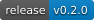
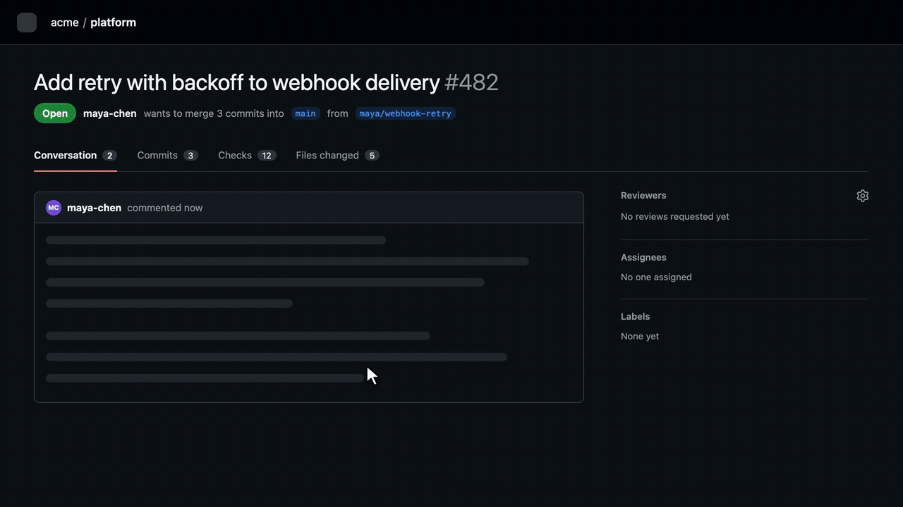
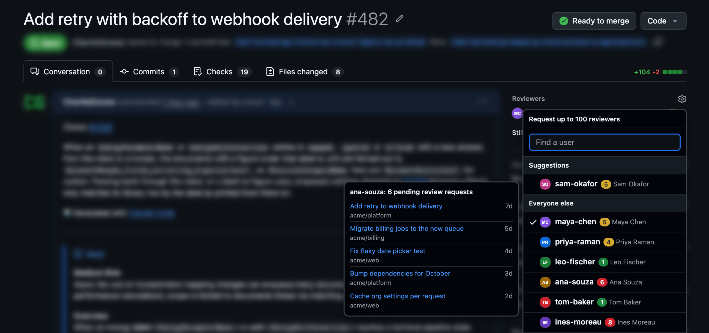

<p align="center">
  
</p>

<h1 align="center">ReviewLoad</h1>

<!-- Badges are local SVGs (GitHub's image proxy times out on shields.io). Bump docs/badges/release.svg when tagging a release. -->
<p align="center">
  <a href="https://github.com/CharlieGroves/review-load/releases/latest"></a>
  
  <a href="PRIVACY.md"></a>
  <a href="LICENSE"></a>
</p>

<p align="center"><b>See how many reviews each teammate is already waiting on, right in GitHub's Reviewers menu, before you add one more.</b></p>

<p align="center">
  <a href="docs/demo.mp4">
    
  </a>
  <br>
  <sub>▶️ <a href="docs/demo.mp4">Watch in full resolution</a> · names and numbers are illustrative</sub>
</p>

---

Open the Reviewers gear on any pull request and each person gets a small pill:

- **The number** is how many open pull requests are waiting on their review right now, not counting the one you're looking at.
- **The colour** goes green → amber → red as that number rises (thresholds are yours to change).
- **Hover** to see the oldest five, with links, and a link to the full list on GitHub.

The same pill appears next to reviewers already on the PR, so you can tell when the person you just added is snowed under.

ReviewLoad only adds information. It never requests reviews, assigns anyone, or changes anything on GitHub.

<p align="center">
  
  <br>
  <sub>On a real pull request (names, avatars and numbers changed)</sub>
</p>

## Install

- Chrome / Edge: _Chrome Web Store link coming once the listing is approved_
- Firefox: _Firefox Add-ons link coming once the listing is approved_
- From source: see [Development](#development)

Want to see it before creating a token? Click the ReviewLoad icon in your toolbar and turn on **Demo mode**: every pill shows clearly labelled sample numbers and nothing is sent anywhere.

## Set up a token (two minutes)

ReviewLoad reads GitHub's search API with your own read-only token. There's no ReviewLoad server.

1. Open **[this pre-filled token form](https://github.com/settings/personal-access-tokens/new?name=ReviewLoad&description=Read-only+token+for+the+ReviewLoad+browser+extension&expires_in=90&pull_requests=read)**. It already sets the name, a 90-day expiry, and **Pull requests: Read-only** (Metadata: Read is added automatically).
2. Set **Resource owner** to your organisation and **Repository access** to **All repositories**.
3. Click **Generate token** and copy it.
4. Click the ReviewLoad icon in your toolbar, paste the token and click **Save**. You should see `Connected as <you>`.

The same pop-up switches between organisation and repository scope, team requests and demo mode. Colour thresholds and removing the token live under **All settings**.

Things that can get in the way:

- **Organisation approval.** Many organisations require an owner to approve fine-grained tokens. Until then, counts will be zero or missing for that organisation.
- **SAML single sign-on.** If your organisation uses SSO, the options page will say so and link to the page where you authorise the token.
- **One owner per token.** A fine-grained token covers one organisation (or your personal account). If you work across several, a classic token with the `repo` scope covers them all, but it also grants write access, so prefer fine-grained where you can.

## What gets counted

A person's number is the count of pull requests that are:

- **open** and **not a draft**,
- in the **same organisation** as the PR you're on (or only the same repository, if you choose that in options),
- with a review **requested from that person directly**, which GitHub clears once they submit a review.

That is exactly this GitHub search, which the "See all" link opens:

```
is:pr is:open draft:false user-review-requested:<login> user:<owner>
```

Known limits:

- **You only see what your token can see.** Two people with access to different repositories can see different numbers for the same teammate.
- **Team requests are off by default**, because a request to a 12-person team would add one to all 12 people. Turn on "Include review requests made to a team" if your team uses them deliberately.
- **Re-reviews.** Once someone reviews a PR, it drops off their count until a review is requested from them again.
- **Search lag.** Right after you add a reviewer, GitHub's search can take a few seconds to catch up. ReviewLoad re-checks shortly after the sidebar changes.
- Numbers are cached for 5 minutes. Older numbers are shown faded, for example while GitHub is asking ReviewLoad to slow down.

## People, not metrics

These numbers exist to protect busy reviewers at the moment someone is choosing who to ask. ReviewLoad deliberately has no leaderboards, no history, no charts and no export. Everything it shows is already visible to anyone with repository access through GitHub search; it just puts it where the decision is made.

## Privacy

- Your token is stored in your browser's local extension storage. It isn't synced between devices and it isn't encrypted at rest, so use a read-only token with an expiry.
- ReviewLoad talks only to `api.github.com`. No analytics, no error reporting, no third-party servers.
- Permissions: `storage`, plus access to `github.com` (to draw the pills) and `api.github.com` (to count).

Full details in [PRIVACY.md](PRIVACY.md).

## FAQ

**Why does it need a token at all?** The counts come from GitHub's search API, which needs authentication to see private repositories and to get a usable rate limit.

**How is this different from GitHub's team auto-assignment?** Auto-assignment only kicks in when you request a whole team, needs an organisation admin to set it up, and shows nobody the numbers. ReviewLoad helps with the reviewers you pick by hand, needs no admin, and works alongside auto-assignment.

**How many API calls does it make?** Opening the picker sends a handful of small GraphQL requests (up to five people each), costing about one point per request against GitHub's 5,000-points-per-hour budget. Results are cached for 5 minutes, so opening it again costs nothing.

**Does it work on GitHub Enterprise Server?** Not yet. It's the first thing planned after v1.

## Development

```sh
npm install
npm run dev        # builds .output/chrome-mv3-dev; load it unpacked and it reloads on change
npm test           # unit and DOM-fixture tests
npm run compile    # type-check
npm run build && npm run build:firefox
npm run zip && npm run zip:firefox   # store-ready zips (Firefox also gets a sources zip)
npm run demo       # re-render docs/demo.mp4 and docs/demo.gif from assets/video/demo.html (needs ffmpeg)
```

Every GitHub selector lives in [`lib/selectors.ts`](lib/selectors.ts), and [`fixtures/pr-sidebar.html`](fixtures/pr-sidebar.html) mirrors the markup it expects. When GitHub changes the picker, those two files are usually the whole fix.

Firefox reviewers: `npm ci && npm run zip:firefox` reproduces the submitted build exactly (Node 24, npm 11).

## Licence

[MIT](LICENSE)
